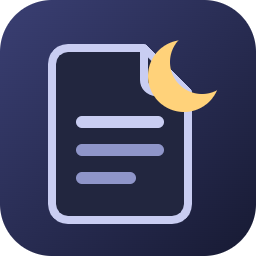
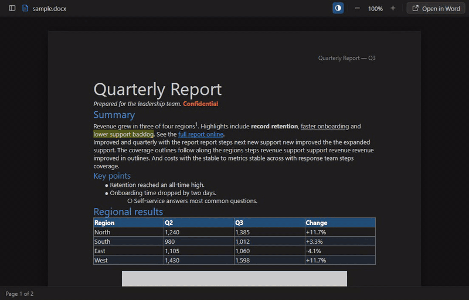
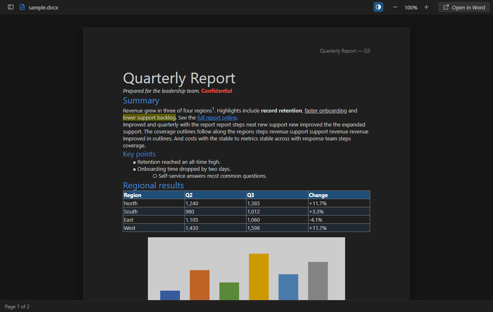
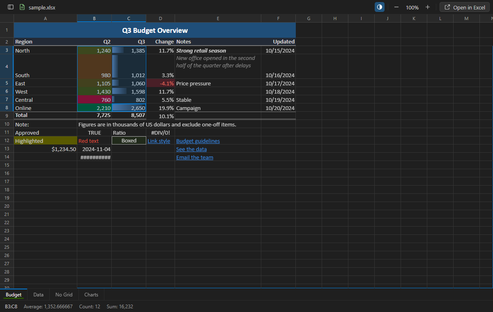
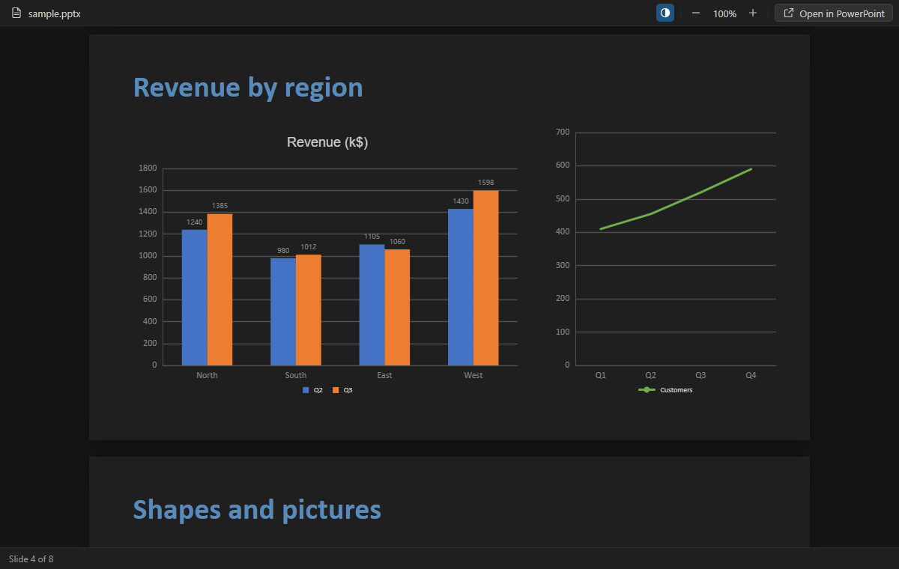
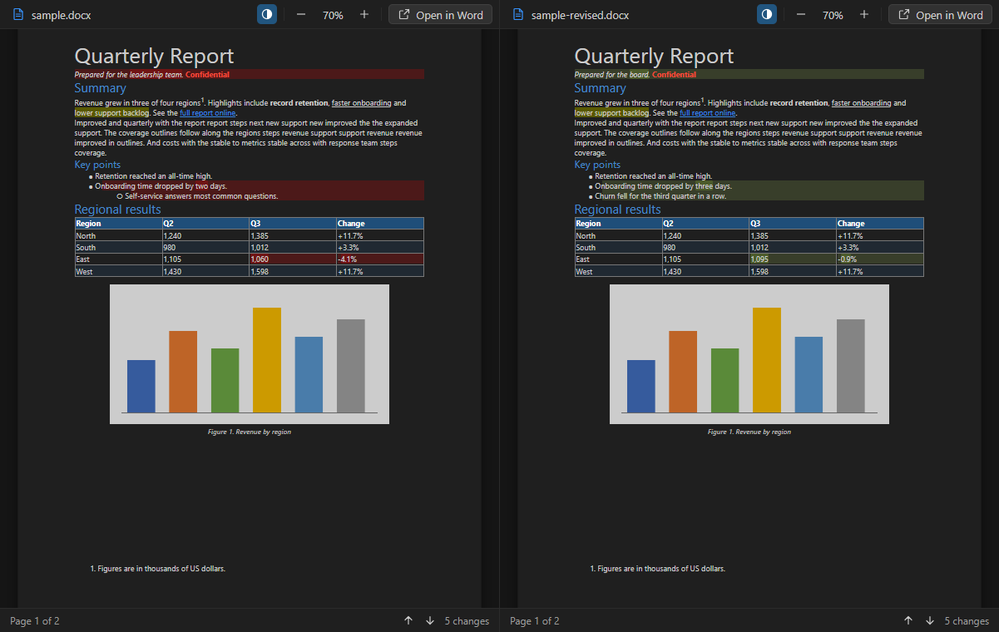
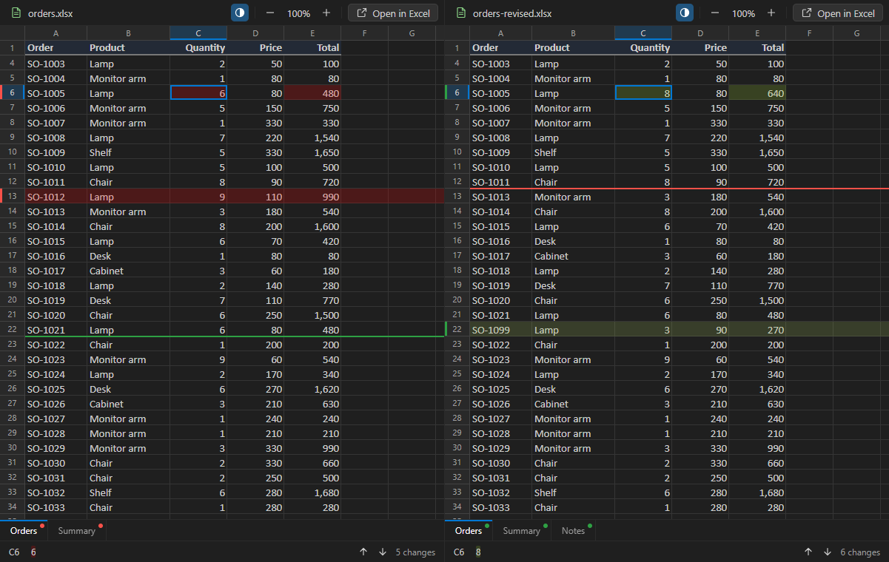
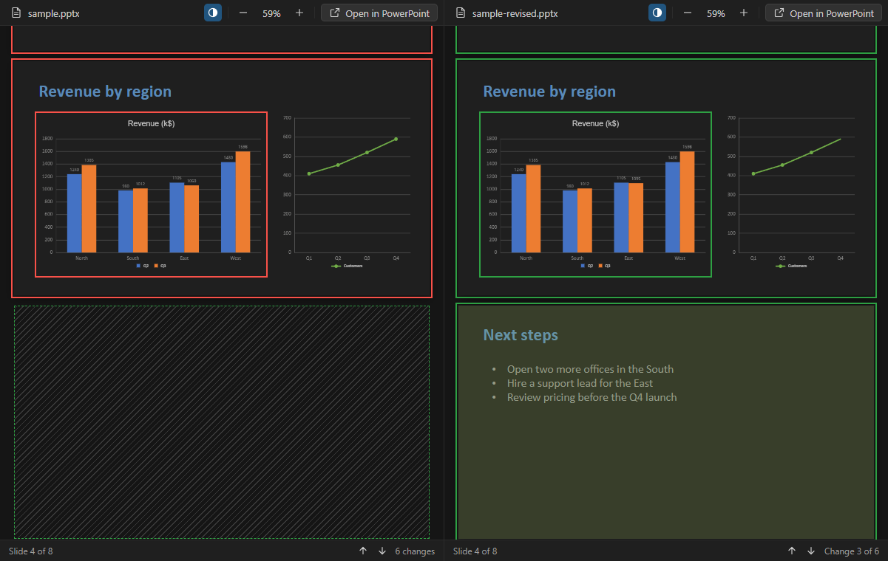

# Nightdocs

[](https://marketplace.visualstudio.com/items?itemName=MBKDevStudio.nightdocs)
[](https://open-vsx.org/extension/MBKDevStudio/nightdocs)
[](https://github.com/mbKalkan/nightdocs/actions/workflows/ci.yml)
[](LICENSE)

**Read Word, Excel and PowerPoint files in VS Code, in your dark theme.**

Nightdocs is a lightweight, view-only Office viewer for Word (`.docx`), Excel (`.xlsx`) and
PowerPoint (`.pptx`) files, templates and macro-enabled files included. Documents take on your
editor's colors so a white page doesn't light up a dark room. Changed files from Git open side by side with the differences
marked, and when you need to edit, one click opens the file in Word, Excel or PowerPoint.



## Why Nightdocs

- **Dark-first.** Pages, text, tables and fills are remapped to your theme. Colors keep their hue
  and text keeps readable contrast. Pictures keep their colors and are only dimmed. One click on
  ◐ shows the original colors.
- **Fast and view-only.** Files open in about a second, and sheets with 100,000 rows scroll
  smoothly. Nothing can be changed by accident.
- **See what changed.** Compare two versions of a document, workbook or presentation side by side,
  straight from Source Control, with the changes marked down to the word or cell.
- **Edit in Office when you need to.** **Open in Word**, **Open in Excel** or **Open in
  PowerPoint** hands the file to its desktop app. The view refreshes when the file is saved.
- **Private.** No telemetry and no network access. Your files never leave your machine.

## Features

### Word (`.docx`, `.docm`, `.dotx`, `.dotm`)



- Page layout with headers, footers, footnotes, tables, lists, images and links
- Comments and tracked changes, as Word's "All Markup" shows them: hover a comment to read it,
  list them all from the status bar, or hide the markup to read the text with all changes accepted
- Documents that Word never paginated (exports from other apps, generated files) are split into
  pages
- A navigation pane with the headings as an outline, as in Word: fold sections, click a heading
  to go there, and see where you are
- The status bar shows the current page; **Go to Heading…** (<kbd>Ctrl</kbd>+<kbd>Shift</kbd>+<kbd>O</kbd>)
  finds a heading as you type
- Find with <kbd>Ctrl</kbd>+<kbd>F</kbd>

### Excel (`.xlsx`, `.xlsm`, `.xltx`, `.xltm`)

- Cell styles, number formats, and dates in your locale's short format
- Merged cells, frozen panes, hidden rows, columns and sheets, and row and column fills
- Text spills into empty neighbors the way it's aligned, including center across selection
- Conditional formatting: highlight rules, color scales and data bars
- Pictures, text boxes and charts; charts follow your theme as in presentations: text and
  gridlines adapt, data keeps its colors
- Select cells with the mouse or keyboard, copy them, and see the cell's text and formula, or Sum,
  Count and Average, in the status bar under the sheet tabs
- **Copy as Markdown Table** (right-click, or the Command Palette) for READMEs, issues and chats;
  with one cell selected, it copies the block of data around it
- Links in cells: <kbd>Ctrl</kbd>+click a linked cell, or the link in the status bar, to open a web
  or mail link (VS Code asks first) or go to the place in the workbook it points to
- Find across the whole sheet, not only the visible cells
- Workbooks with many sheets: scroll the tabs with the mouse wheel or the arrows, pick a sheet
  from **All Sheets** (also **Go to Sheet…**, <kbd>Ctrl</kbd>+<kbd>Shift</kbd>+<kbd>O</kbd>), where
  typing filters the list, or keep them all in view in the navigation pane



### PowerPoint (`.pptx`, `.pptm`, `.ppsx`, `.ppsm`, `.potx`, `.potm`)

- Slides with text, bullets, tables, shapes, pictures, SmartArt and charts
- Charts follow your theme too: text and gridlines adapt, data keeps its colors
- Slides designed dark, or drawn on a picture, keep their look
- Hidden slides are shown dimmed and marked
- A slide pane with thumbnails, as in PowerPoint, that follows the slide you're on
- Speaker notes under each slide, as in PowerPoint's notes pane; **Notes** in the status bar hides
  them
- The status bar shows the current slide; <kbd>Page Down</kbd> and <kbd>Page Up</kbd> step from
  slide to slide, **Go to Slide…** (<kbd>Ctrl</kbd>+<kbd>Shift</kbd>+<kbd>O</kbd>) lists them by
  title, and links between slides work
- Find with <kbd>Ctrl</kbd>+<kbd>F</kbd>



### Comparing versions

- Open a changed Word document, Excel workbook or PowerPoint presentation from **Source Control**
  (changes or staged changes), or compare two files with **Select for Compare**, and Nightdocs
  shows both versions side by side. There is nothing to set up: VS Code uses Nightdocs for both
  sides.
- Word: edited, added and removed paragraphs and table cells are marked, down to the changed words
- Excel: changed cells and added and removed rows and columns are marked, and sheet tabs with
  changes get a dot; moving between changes goes from sheet to sheet, and switching sheets on one side switches
  the other. Selecting cells on one side selects the same cells on the other, and the status bar
  marks what changed in the selected cell
- PowerPoint: edited slides are outlined with their changed words, pictures and charts marked;
  added and removed slides are tinted, with an empty stand-in on the other side so both decks line
  up
- Both sides scroll and zoom together; <kbd>F7</kbd> and <kbd>Shift</kbd>+<kbd>F7</kbd> or the arrows in the
  status bar move between changes







### Everywhere

- Zoom with the toolbar, the keyboard, <kbd>Ctrl</kbd>+mouse wheel or pinch
- The navigation pane opens from the button at the left of the toolbar or with **Toggle
  Navigation Pane**, and stays open for files of that kind
- Point an AI assistant or a teammate at a place in a document: right-click and choose **Copy
  Reference** to get `docs/report.docx, page 3, under "Regional results"` on the clipboard, ready
  to paste into a chat with Claude Code or any assistant that works in your workspace. **Copy
  Reference with Text** adds the paragraph, the selected cells as a Markdown table, or the
  slide's text
- Live reload that keeps your place
- Dark, light and high contrast themes
- Keyboard and screen reader support
- English and Turkish
- Works in VS Code for the Web too: open Office files on [vscode.dev](https://vscode.dev) and
  [github.dev](https://github.dev) without installing anything

## Getting started

1. Install **Nightdocs** from the
   [Visual Studio Marketplace](https://marketplace.visualstudio.com/items?itemName=MBKDevStudio.nightdocs)
   or, in VSCodium and other editors that use it,
   [Open VSX](https://open-vsx.org/extension/MBKDevStudio/nightdocs). Or search for "Nightdocs"
   in the Extensions view.
2. Open a Word, Excel or PowerPoint file: `.docx`, `.xlsx` or `.pptx`, or one of their
   macro-enabled (`.docm`, `.xlsm`, `.pptm`, `.ppsm`) and template (`.dotx`, `.xltx`, `.potx`)
   variants. Nightdocs is the default viewer for these files.

If another extension also opens these files, right-click the file and choose
**Open With… › Nightdocs**, then **Configure default editor**. Or add this to your settings:

```json
"workbench.editorAssociations": {
  "*.docx": "nightdocs.viewer",
  "*.xlsx": "nightdocs.viewer",
  "*.xlsm": "nightdocs.viewer",
  "*.pptx": "nightdocs.viewer"
}
```

## Keyboard shortcuts

| Action                        | Windows / Linux                                                  | macOS                                                           |
| ----------------------------- | ---------------------------------------------------------------- | --------------------------------------------------------------- |
| Zoom in / out                 | <kbd>Ctrl</kbd>+<kbd>=</kbd> / <kbd>Ctrl</kbd>+<kbd>-</kbd>      | <kbd>Cmd</kbd>+<kbd>=</kbd> / <kbd>Cmd</kbd>+<kbd>-</kbd>       |
| Reset zoom                    | <kbd>Ctrl</kbd>+<kbd>Numpad 0</kbd>                              | <kbd>Cmd</kbd>+<kbd>Numpad 0</kbd>                              |
| Find                          | <kbd>Ctrl</kbd>+<kbd>F</kbd>                                     | <kbd>Cmd</kbd>+<kbd>F</kbd>                                     |
| Next / previous sheet         | <kbd>Ctrl</kbd>+<kbd>Alt</kbd>+<kbd>PgDn</kbd> / <kbd>PgUp</kbd> | <kbd>Cmd</kbd>+<kbd>Alt</kbd>+<kbd>PgDn</kbd> / <kbd>PgUp</kbd> |
| Copy selected cells           | <kbd>Ctrl</kbd>+<kbd>C</kbd>                                     | <kbd>Cmd</kbd>+<kbd>C</kbd>                                     |
| Next / previous slide         | <kbd>PgDn</kbd> / <kbd>PgUp</kbd>                                | <kbd>PgDn</kbd> / <kbd>PgUp</kbd>                               |
| Go to heading, slide or sheet | <kbd>Ctrl</kbd>+<kbd>Shift</kbd>+<kbd>O</kbd>                    | <kbd>Cmd</kbd>+<kbd>Shift</kbd>+<kbd>O</kbd>                    |
| Next / previous change        | <kbd>F7</kbd> / <kbd>Shift</kbd>+<kbd>F7</kbd>                   | <kbd>F7</kbd> / <kbd>Shift</kbd>+<kbd>F7</kbd>                  |

## Limitations

- The older binary formats (`.doc`, `.xls`, `.ppt`) aren't supported yet.
- In VS Code for the Web there is no desktop Office to hand a file to, so **Open in Office** isn't
  offered there.
- Password-protected files can't be opened; Nightdocs says so and offers to open them in Office.
- Excel formulas aren't recalculated: cells show the values saved in the file.
- Excel icon sets and conditional formatting rules with custom formulas aren't drawn yet.
- Comparisons go by content, not formatting: a changed font or color isn't marked. In Excel a
  formula that changed but gives the same value isn't marked; in PowerPoint slides compare by
  their text, pictures and chart data, and a moved slide shows as removed in one place and added in
  another. Files in Git LFS compare only when their content is on this machine: Nightdocs doesn't
  download it.
- PowerPoint animations and transitions aren't shown. Embedded audio and video play only in
  formats VS Code can decode, which usually leaves out MP4 video. Some pasted vector pictures
  (EMF/WMF) appear as placeholders.

## Contributing

Bug reports and ideas are welcome in [issues](https://github.com/mbKalkan/nightdocs/issues).
See [CONTRIBUTING.md](CONTRIBUTING.md) to build and test the extension.

## License

[MIT](LICENSE). Third-party components and their licenses are listed in
[THIRD_PARTY_NOTICES.md](THIRD_PARTY_NOTICES.md).
