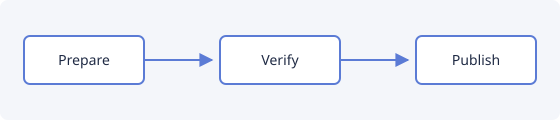

# Release checklist

 

Use this list before every release. It assumes the **main** branch is green and that
`CHANGELOG.md` has an _Unreleased_ section. See [Publishing](#publishing) for the last step,
or the [contributing guide](../../../CONTRIBUTING.md) for how changes land.

> [!NOTE]
> Releases are made by hand; nothing here publishes on its own.

## Prepare

1. Update the version in `package.json` and `package-lock.json`.
2. Move the notes from _Unreleased_ to the new version.
3. Check that the README screenshots match the new version.
4. Run the checks:

   ```bash
   npm run typecheck && npm run lint
   npm test -- --coverage
   ```

- [x] Version bumped
- [x] Notes moved
- [x] Screenshots updated

## Verify

| Check        |        Command        |  Time |
| :----------- | :-------------------: | ----: |
| Unit tests   |      `npm test`       |   6 s |
| Visual tests | `npm run test:visual` | 2 min |
| Smoke tests  | `npm run test:smoke`  | 1 min |

> [!CAUTION]
> Never publish while a check is red, even if it looks flaky.



## Publishing

Tag the release and let the workflow build the package:

```ts
const tag = `v${version}`;
// Nothing is pushed yet.
await git('tag', '--sign', tag);
```

Then upload the `.vsix` to the Marketplace[^1]. Press <kbd>Ctrl</kbd>+<kbd>C</kbd> to copy a
path, and see the [release page](https://github.com/mbKalkan/nightdocs/releases) for older ones.


## Announce

Post the highlights in the discussion board and link the release notes.

---

[^1]: The Marketplace takes a few minutes to show a new version.
